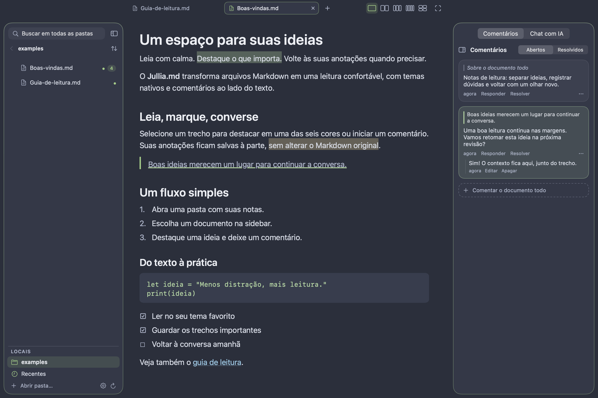
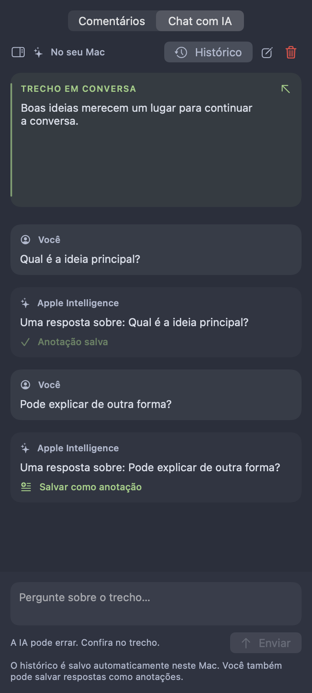
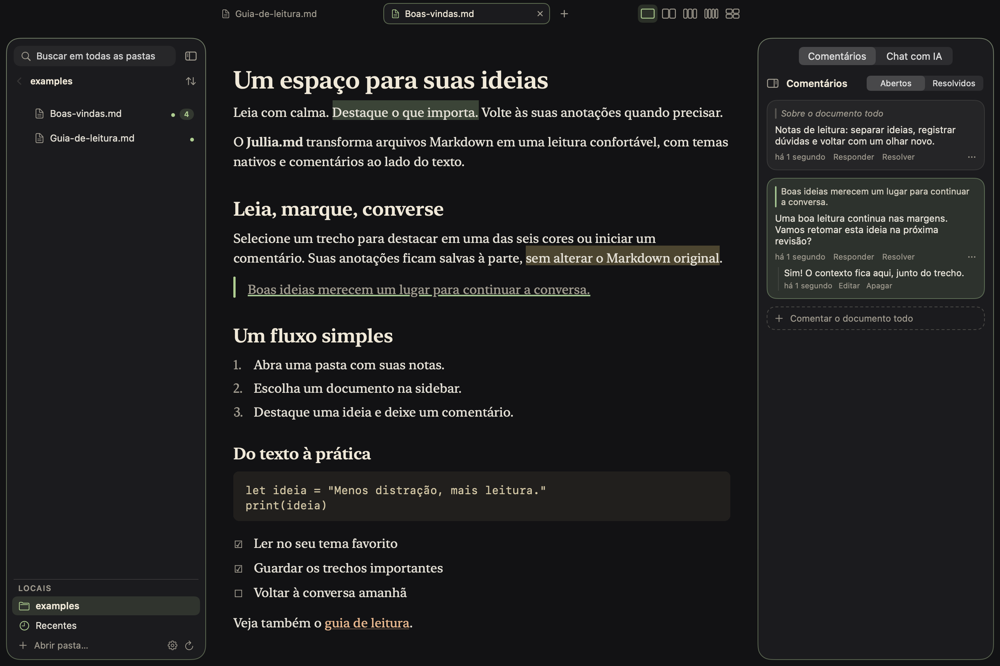
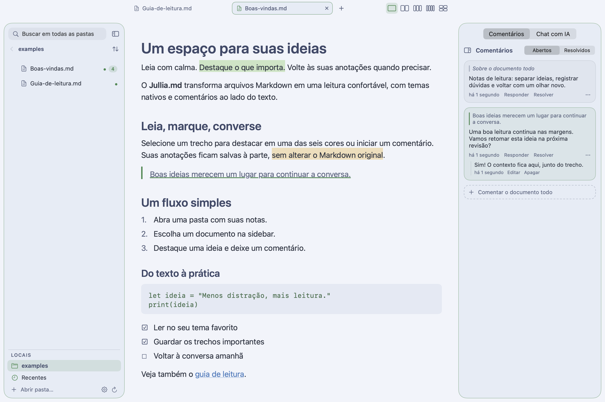
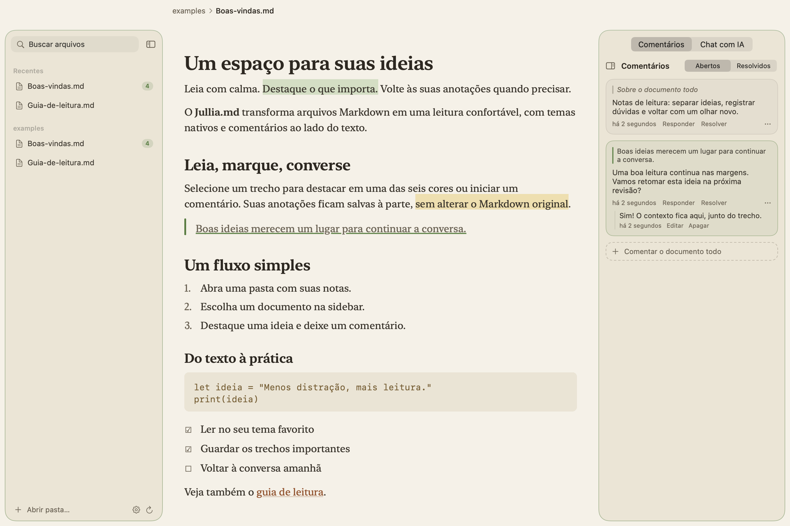
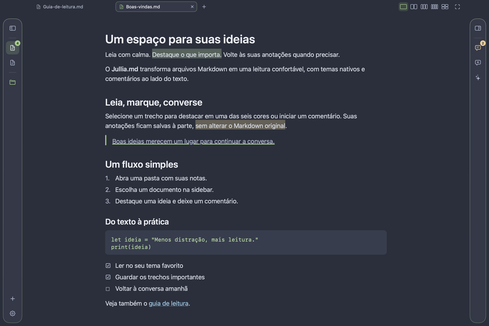

# Jullia.md

**Leia com calma. Destaque o que importa. Continue a conversa nas margens.**

Jullia.md é um visualizador de Markdown e PDF nativo para macOS, feito em SwiftUI e AppKit. Leia, destaque, anote e converse sobre trechos com a Apple Intelligence local, sem modificar os arquivos originais.



**macOS 27+ · Swift 6.4 · Interface em português · Versão 0.8.0**

[Instalação](#instalação) · [PDFs](#pdfs) · [Chat com IA](#chat-com-ia) · [Temas](#temas-e-aparência) · [Atalhos](#atalhos) · [Desenvolvimento](#desenvolvimento)

## Novidades da versão 0.8.0

- **Split**: até quatro documentos lado a lado, em 2, 3 ou 4 colunas ou numa grade 2×2, com divisórias arrastáveis.
- Cada painel tem um cabeçalho numerado; as abas mostram o número do painel onde estão. Comentários, chat e atalhos agem no painel focado.
- **Abrir ao lado**, no menu do arquivo ou da aba, abre um documento num painel novo.
- PDFs se ajustam à largura de painéis estreitos, até 100%.

## Novidades da versão 0.7.0

- **Abas**: vários documentos abertos, na faixa superior da janela, cada um lembrando a página, o zoom ou a rolagem.
- **Aba de prévia**: um clique na sidebar abre o arquivo numa aba em itálico, substituída pelo próximo clique. Ela vira fixa com duplo clique, ao anotar ou ao mudar de página.
- As abas abertas voltam na próxima vez que o app abre; os arquivos abertos têm um ponto na sidebar.

## Novidades da versão 0.6.0

- Sidebar de arquivos reorganizada: mostra uma pasta por vez, como árvore, começando pela pasta do documento aberto.
- Breadcrumb para subir de nível e **Entrar na pasta** (duplo clique) para focar uma subpasta.
- Seção **Locais** com as pastas abertas e os **Recentes**; pastas de arquivos soltos podem ser adicionadas aos Locais.
- Busca em todas as pastas, com o caminho de cada resultado, e ordenação por nome ou data de modificação.
- Nomes longos quebram em duas linhas em vez de perder o meio.

## Novidades da versão 0.5.0

- Leitura de PDFs com zoom, seleção entre páginas e anotações por trecho.
- Aba **Chat com IA** para conversar sobre seleções de PDF e Markdown usando Foundation Models, no próprio Mac.
- Histórico persistente por documento, com reabertura, continuação e exclusão por uma lixeira vermelha.
- Respostas salvas como anotações com identificação permanente de origem da IA.

O banco local é atualizado automaticamente na primeira abertura, preservando os destaques e comentários existentes.

## O que você pode fazer

- **Ler Markdown com controles nativos:** títulos, listas, tarefas, tabelas, citações, blocos de código, links e imagens locais.
- **Ler e anotar PDFs:** páginas e zoom nativos, destaques em seis cores e comentários vinculados a trechos, inclusive entre páginas.
- **Navegar por pastas:** uma pasta por vez em árvore, a partir do documento aberto, com breadcrumb, busca em todas as pastas, ordenação por nome ou data, recentes e contadores de anotações.
- **Destacar em seis cores:** amarelo, verde, azul, rosa, roxo e laranja, com uma barra flutuante sobre a seleção.
- **Comentar trechos ou o documento inteiro:** responder, editar, resolver, reabrir e escolher a cor de cada conversa.
- **Conversar sobre um trecho com IA:** selecione texto no Markdown ou PDF, converse com o modelo local da Apple Intelligence e salve respostas como anotações identificadas como IA.
- **Retomar conversas:** consulte o histórico de cada documento, continue uma conversa anterior ou exclua suas mensagens sem apagar anotações salvas.
- **Acompanhar alterações externas:** recarregamento automático e tentativa de reencontrar os trechos anotados após uma edição.
- **Ajustar a leitura:** quatro temas, tamanho do texto, largura da coluna e transparência independente para cada painel.
- **Recolher as sidebars:** mais espaço para ler, com acesso rápido a arquivos e comentários pelas barras laterais.

O app funciona com arquivos locais e mantém as anotações e o histórico de IA em SQLite. Não exige conta no Jullia nem um serviço de sincronização.

## Instalação

### Requisitos

| Requisito | Versão |
| --- | --- |
| macOS | 27 ou superior |
| Xcode completo | 27, com o SDK do macOS 27 e `actool` |
| Swift | 6.4 ou superior |

O projeto foi validado em Apple Silicon com macOS 27.0.1, Xcode 27.0 e Swift 6.4. O script compila para a arquitetura do Mac usado; não gera um binário universal. As Command Line Tools isoladas não substituem o Xcode completo para compilar o ícone.

### Compilar e abrir

```bash
git clone https://github.com/rheav/jullia-md.git
cd jullia-md
swift test
./scripts/build-app.sh
open build/Jullia.md.app
```

O Swift Package Manager baixa as dependências na primeira compilação. As versões resolvidas estão em [`Package.resolved`](Package.resolved).

O script cria `build/Jullia.md.app` em modo release, compila o ícone em camadas e aplica uma assinatura ad-hoc. Essa assinatura permite o uso local; o bundle não é notarizado para distribuição. A versão do app vem de [`VERSION`](VERSION).

### Instalar ou atualizar em Applications

Em um checkout existente, obtenha a versão mais recente antes de instalar:

```bash
git pull --ff-only origin main
./scripts/install.sh
```

O instalador compila o app, pede que uma cópia em execução encerre normalmente, substitui `/Applications/Jullia.md.app`, registra o bundle no macOS e o reabre. As preferências e anotações ficam fora do bundle e são preservadas.

Para instalar sem abrir ao final:

```bash
./scripts/install.sh --no-open
```

## Como usar

### Abrir seus documentos

Use **⌘O** para abrir arquivos ou **⇧⌘O** para adicionar uma pasta. Também é possível arrastar arquivos e pastas para a sidebar ou para a tela inicial, e abrir um `.md` ou `.pdf` pelo Finder com **Abrir com → Jullia.md**.

Para experimentar, abra a pasta [`examples`](examples) e selecione [`Boas-vindas.md`](examples/Boas-vindas.md). Os textos de demonstração vêm sem anotações; os comentários das imagens são criados pelo gerador de screenshots.

A árvore reconhece `.md`, `.markdown`, `.mdown`, `.mkd` e `.pdf`, ignora arquivos ocultos e links simbólicos e omite pastas sem Markdown ou PDF. Diretórios de build e dependências, como `node_modules`, `.build`, `build`, `dist`, `DerivedData` e `Pods`, ficam fora da navegação. A busca procura nomes de arquivos em todas as pastas, sem diferenciar maiúsculas ou acentos, e mostra onde cada resultado está.

A sidebar mostra uma pasta por vez. Ao abrir um documento, ela vai para a pasta dele, ou abre o caminho até ele se o arquivo estiver dentro da pasta mostrada. Clique numa subpasta para abri-la no lugar; dê duplo clique (ou use **Entrar na pasta**) para que ela vire o topo da árvore. O breadcrumb sobe de volta até a pasta adicionada, nunca acima dela. Um arquivo aberto fora dessas pastas mostra a própria pasta, até quatro níveis abaixo, com o botão **⊕** para adicioná-la aos **Locais**. O botão **⇅** ordena por nome ou por data de modificação (mais recentes primeiro); as pastas vêm sempre antes dos arquivos.

### Abas

Um clique num arquivo da sidebar o abre na **aba de prévia**, com o nome em itálico: o próximo arquivo clicado toma o lugar dela, então dá para folhear uma pasta sem acumular abas. A prévia vira uma aba fixa com um duplo clique (no arquivo ou na aba), ao destacar ou comentar, ao mudar de página no PDF ou ao rolar o Markdown. **Abrir em nova aba**, no menu do arquivo, e os arquivos abertos por **⌘O**, pelo Finder ou arrastados já abrem fixos. Um arquivo já aberto não é aberto de novo: o app vai para a aba dele.

Cada aba guarda onde a leitura estava: página, posição e zoom no PDF, rolagem no Markdown. O menu da aba fecha as outras ou as da direita. As abas e a aba ativa são restauradas ao reabrir o app, se **Reabrir as pastas e as abas ao iniciar** estiver ligado em Ajustes → Geral; os documentos das abas que não estão na tela só são lidos quando você volta a elas.

### Lado a lado

Os botões de layout no fim da barra de abas (ou **Abas → Layout**, **⌥⌘1** a **⌥⌘5**) dividem a área de leitura em um painel, duas, três ou quatro colunas, ou numa grade 2×2. Ao ganhar painéis, eles recebem as próximas abas que não estão na tela; ao perder, as abas continuam na barra. Arraste as divisórias para mudar o tamanho dos painéis; o tamanho e o layout voltam na próxima abertura.

Clique em qualquer ponto de um painel para focá-lo: o painel focado tem o número e o filete em verde, e a sidebar de comentários, o chat, os menus e os atalhos de zoom agem nele. Clicar numa aba que já está num painel foca esse painel; uma aba fora da tela abre no painel focado. **Abrir ao lado**, no menu de um arquivo da sidebar ou de uma aba, abre o documento num painel novo à direita. O ✕ do cabeçalho fecha o painel, não a aba. Um mesmo arquivo aparece em um painel por vez.

### Destacar e comentar

Selecione um trecho para abrir a barra de marcação. Escolha uma cor para destacar, o balão para comentar ou o botão de cópia para copiar o texto. O menu contextual também oferece essas ações. Clique em um destaque existente para mudar sua cor ou removê-lo.

Na sidebar de comentários, você pode iniciar uma conversa sobre o documento inteiro, responder a uma conversa existente e alternar entre **Abertos** e **Resolvidos**. Clicar em um comentário vinculado a um trecho leva até sua posição no documento.

### PDFs

PDFs abrem no leitor nativo PDFKit. Selecione texto para destacar, comentar ou copiar; clique em um destaque para mudar sua cor ou removê-lo. Clicar em um comentário na sidebar navega até o trecho. As seleções podem atravessar páginas e as anotações continuam disponíveis ao reabrir o arquivo.

A barra do PDF mostra a página atual e oferece zoom e ajuste à janela. Ao abrir, a página acompanha a largura do painel sem passar de 100%, então cabe inteira num painel estreito; **Ajustar** preenche a largura do painel. Com um PDF aberto, **⌘+**, **⌘−** e **⌘0** controlam o zoom. As cores do documento original são preservadas; os temas alteram a interface e as marcações do Jullia.

PDFs protegidos pedem senha, que não é salva. PDFs sem texto extraível podem ser visualizados e receber comentários sobre o documento inteiro; reconhecimento de texto em imagens (OCR) não está incluído. As anotações ficam no SQLite, não são gravadas nem exportadas para o PDF. Marcações já existentes no arquivo continuam visíveis e não são importadas como conversas do Jullia.

Após uma alteração externa, o app tenta reencontrar cada trecho pelo texto e pelo contexto das páginas. Se parte da seleção desaparecer, a anotação fica em **Órfãos**. A recuperação é aproximada e depende do texto extraído pelo PDFKit.

### Chat com IA

Selecione um trecho e clique em **✨**, escolha **Conversar sobre trecho** no menu contextual ou pressione **⌥⌘I**. A aba **Chat com IA** abre no painel da direita, com a citação fixa acima da conversa. Faça perguntas sucessivas, use **⌘Return** para enviar e **Parar** para interromper uma resposta.

O recurso usa o modelo local do framework Foundation Models. Requer Apple Intelligence disponível no Mac, com o modelo baixado e suporte a português. A interface informa quando o modelo está indisponível e permite verificar novamente. Não há chave de API, servidor próprio nem fallback para nuvem.

**Salvar como anotação** guarda uma resposta completa nos comentários do trecho, com o selo **Gerada por IA · Apple Intelligence**, preservado mesmo após editar a anotação. O arquivo original permanece intacto.

As conversas são salvas automaticamente neste Mac, por documento. Clique em **Histórico** para ver conversas anteriores, reabrir uma delas e continuar de onde parou, inclusive após fechar o app. **Nova conversa** preserva a anterior no histórico. Cada conversa tem uma **lixeira vermelha** para excluí-la; a conversa aberta também pode ser excluída pela lixeira do cabeçalho. Excluir uma conversa não apaga respostas já salvas como anotações. Conversas feitas antes da versão com histórico não podem ser recuperadas se já foram descartadas.

A IA pode errar. Trechos grandes demais são recusados sem corte silencioso. Quando a conversa cresce, o app mantém o trecho e os turnos mais recentes no contexto do modelo e informa isso na interface; o histórico visível permanece completo. PDFs precisam ter texto selecionável; OCR não está incluído.

| Conversa sobre um trecho | Histórico por documento |
| --- | --- |
|  |  |

As imagens usam conversas de demonstração para mostrar os controles da interface.

### Editar no seu editor favorito

Jullia.md é um leitor: a edição do Markdown acontece em outro app. Com o recarregamento automático ativado, alterações no disco atualizam a leitura. **⌘R** força uma atualização do documento e das pastas.

Cada anotação guarda o texto selecionado, sua posição e um pouco do contexto ao redor. Se o trecho mudar de posição, o app tenta reencontrá-lo. Quando não consegue, preserva a anotação na seção **Órfãos**. A recuperação depende de ainda haver texto suficiente para identificar o trecho.

## Temas e aparência

| Polar | Ink |
| --- | --- |
|  |  |
| Escuro, azul acinzentado, fonte de sistema. | Escuro, tons de grafite, fonte serifada. |

| Snow | Paper |
| --- | --- |
|  |  |
| Claro, neutro, fonte de sistema. | Claro, quente, fonte serifada. |

Em **Ajustes → Aparência**, escolha um tema fixo ou acompanhe o modo claro/escuro do macOS com um tema para cada modo. A transparência da janela, da sidebar de arquivos e da sidebar de comentários pode ser ajustada separadamente, de **0% a 85%**. O app respeita **Reduzir transparência** do macOS.

Em **Ajustes → Geral**, ajuste o texto de **12 a 26 pt**, a largura desejada da coluna de **520 a 1100 pt**, o recarregamento automático e a reabertura da sessão anterior.

### Mais espaço para ler

Recolha os painéis para manter apenas as barras de ícones. Passe o ponteiro sobre a barra de comentários para uma prévia, ou clique para mantê-la aberta.



As imagens são snapshots das views de produção, renderizadas em AppKit com conteúdo de demonstração. Usam superfícies opacas para não depender do fundo da área de trabalho; o desfoque do Liquid Glass aparece ao ativar a transparência no app. Veja [como gerar as imagens novamente](docs/screenshots/README.md).

## Atalhos

| Atalho | Ação |
| --- | --- |
| ⌘O | Abrir arquivo ou pasta |
| ⇧⌘O | Adicionar pasta |
| ⌘R | Recarregar documento e pastas |
| ⌘W | Fechar a aba; sem abas, a janela |
| ⇧⌘] / ⇧⌘[ | Próxima aba / aba anterior |
| ⌘1 … ⌘8 / ⌘9 | Ir para a aba N / para a última aba |
| ⌥⌘1 … ⌥⌘5 | Um painel / 2, 3 ou 4 colunas / grade 2×2 |
| ⇧⌘H | Destacar a seleção com a última cor usada |
| ⌥⌘M | Comentar a seleção; sem seleção, comentar o documento |
| ⌥⌘I | Conversar sobre o trecho selecionado com IA |
| ⌃⌘S | Expandir ou recolher arquivos |
| ⌥⌘0 | Expandir ou recolher comentários |
| ⌃⌘1 / 2 / 3 / 4 | Polar / Ink / Snow / Paper |
| ⌘+ / ⌘− | Aumentar ou diminuir o texto; em PDF, ajustar o zoom |
| ⌘0 | Restaurar o texto para 16 pt; em PDF, ajustar à janela |
| ⌘, | Abrir ajustes |
| ⌘↩ | Enviar o comentário em edição ou a pergunta no chat |
| Esc | Cancelar a edição de comentário ou dispensar a prévia lateral |

## Seus dados

| Dado | Onde fica |
| --- | --- |
| Arquivos Markdown e PDF | Nas pastas que você abriu; o app não os sobrescreve |
| Destaques, comentários e histórico de IA | `~/Library/Application Support/Jullia/annotations.sqlite` |
| Preferências, pastas e arquivos recentes | UserDefaults, domínio `dev.rheav.jullia` |

As anotações e conversas são associadas ao caminho absoluto do arquivo, com links simbólicos resolvidos. **Mover ou renomear um documento não transfere suas anotações e seu histórico automaticamente.**

Para fazer backup, encerre o app e copie a pasta inteira `~/Library/Application Support/Jullia`, além dos seus documentos. O banco usa WAL; enquanto aberto, pode haver arquivos auxiliares `annotations.sqlite-wal` e `annotations.sqlite-shm`.

Até a versão 0.2.0, o projeto se chamava **Marknord**. Na primeira abertura como Jullia.md, a migração copia as preferências antigas e, se ainda não existir a pasta de dados Jullia, copia os dados de `~/Library/Application Support/Marknord`. Os dados antigos permanecem no local original.

## Limitações atuais

- Uma janela principal, sem edição de Markdown. Abas não podem ser arrastadas para reordenar.
- A busca da sidebar procura nomes de arquivos; não indexa o conteúdo das pastas.
- Imagens locais são renderizadas. Imagens remotas aparecem como texto alternativo, sem download automático.
- Blocos de código usam fonte monoespaçada, sem realce de sintaxe por linguagem.
- HTML não é interpretado como uma página web; comentários HTML em blocos separados são omitidos e o restante aparece como texto. Diagramas Mermaid e fórmulas matemáticas não têm renderização dedicada.
- As tarefas do Markdown são apresentadas para leitura, sem alterar seus checkboxes no arquivo.
- Não há sincronização integrada, exportação de anotações ou colaboração entre dispositivos.
- A varredura de pastas tem limite de profundidade de 12 níveis; prefira abrir pastas de notas ou projetos específicos.

## Desenvolvimento

```bash
swift build                  # Compilação de desenvolvimento
swift test                   # Testes do core e da integração com o app
CONFIG=debug ./scripts/build-app.sh
./scripts/screenshots.sh     # Atualiza as imagens do leitor, chat e histórico
JULLIA_TEST_APPLE_INTELLIGENCE=1 swift test --filter nativeModelSmoke
```

Abra [`Package.swift`](Package.swift) no Xcode para trabalhar no pacote. Para testar a integração com Finder, o ícone e a identidade de preferências do app instalado, use o bundle produzido por `build-app.sh`.

```text
Sources/
  Jullia/                   App SwiftUI, modelos, preferências e observação de arquivos
    Views/                  Leitor AppKit, sidebars, cards, controles e ajustes
  JulliaCore/               Renderer Markdown, temas, âncoras, SQLite e árvore de arquivos
Tests/
  JulliaCoreTests/          Renderização, layout TextKit, âncoras, banco e navegação
  JulliaAppTests/           PDF, chat, histórico, sessão, recarregamento e snapshots opcionais
assets/icon/AppIcon.icon/   Ícone em camadas do Icon Composer
examples/                  Documentos para experimentar o app
scripts/                   Build do bundle, instalação e screenshots
docs/                      Arquitetura, imagens e especificação original
```

O parser usa `swift-markdown` 0.9.0; SQLite, PDFKit e Foundation Models vêm do sistema. A interface combina SwiftUI com um `NSTextView` em TextKit 1 para Markdown e `PDFView` do PDFKit para PDFs, sem WebView. Os testes de chat usam um gerador controlado; o teste opcional acima faz duas perguntas ao modelo real com texto sintético e informa quando ele está indisponível. Os detalhes do fluxo de documentos, chat e persistência estão em [Arquitetura](docs/architecture.md). Para contribuir, consulte [CONTRIBUTING.md](CONTRIBUTING.md).

## Resolução de problemas

**O Swift não reconhece a versão do pacote ou o SDK.** Confira `swift --version`, `xcodebuild -version` e `xcode-select -p`. Se o Xcode correto estiver em `/Applications/Xcode.app`, você pode selecionar suas ferramentas apenas para o comando:

```bash
DEVELOPER_DIR=/Applications/Xcode.app/Contents/Developer ./scripts/build-app.sh
```

**A compilação reclama de caminhos de uma pasta antiga.** Se você moveu o checkout, execute `swift package clean` e compile novamente para reconstruir os artefatos locais.

**O arquivo não aparece na árvore.** Verifique a extensão, se está em uma pasta ignorada ou oculta e se é um link simbólico. Use **⌘R** para atualizar.

**Uma anotação perdeu o trecho.** Procure em **Órfãos**. Se você moveu ou renomeou o arquivo, abrir o caminho original volta a usar a chave das anotações anteriores.

**O instalador informa que o app ainda está em execução.** Encerre Jullia.md normalmente e execute a instalação novamente. O script não força o encerramento.
